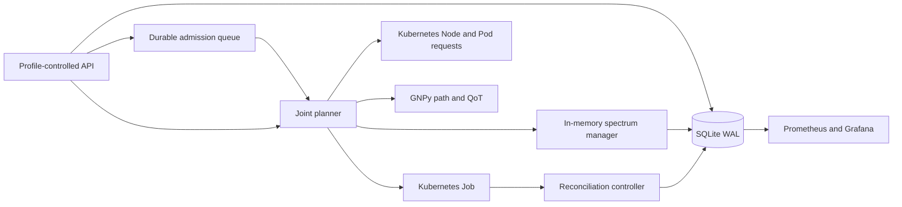

# Compute-Optical Orchestrator

[](https://github.com/bupt20220407/compute-optical-orchestrator/actions/workflows/ci.yml)

Compute-Optical Orchestrator is a reproducible engineering research prototype
that jointly selects Kubernetes compute capacity and an optical path/spectrum
allocation before launching a workload as a Kubernetes Job.

> **Status:** `v0.1.x` engineering research prototype. Internal milestones such
> as v8-v13 are development labels rather than public releases. The checked-in
> evidence uses modeled optical topologies, synthetic workloads, and local kind
> clusters; it does not establish physical-system performance or production
> readiness.

The project focuses on orchestration correctness: deterministic submission,
failure compensation, restart recovery, reconciliation, audit events, and
observable resource state. It is not a production optical controller and does
not provision physical optical devices.

## System flow



For each candidate compute node, the planner:

1. Reads live allocatable resources minus active Pod requests.
2. Filters accelerator count, resource name, product, memory, interconnect,
   and partition-mode constraints before optical computation.
3. Asks GNPy to discover a feasible path and spectrum width `M`.
4. Finds the first available frequency index `N` on every route link.
5. Re-runs GNPy with the explicit `N/M` allocation to verify QoT.
6. Scores feasible candidates and reserves spectrum for the selected plan.
7. Creates a Job constrained to the site, hostname, extended resource, and
   accelerator node affinity.

## Implemented guarantees

- Kubernetes is the source of truth for compute capacity.
- Runtime Kubernetes operations use the official Python client with local
  kubeconfig or in-cluster ServiceAccount credential discovery.
- Accelerator discovery supports NVIDIA GPU, Huawei Ascend NPU, AMD GPU, and
  configurable extended-resource names, with live Pod request accounting.
- Accelerator capability constraints are enforced in both candidate filtering
  and the final Kubernetes Job manifest.
- The v3 API provides durable asynchronous admission with tenant backpressure,
  fair tenant rotation, priority aging, exponential retry, and crash recovery.
- Spectrum conflicts are checked across every shared fiber link.
- SQLite enforces a unique claim for every fiber-link/slot-index pair when a
  selected plan is committed, preventing stale concurrent plans from both
  succeeding.
- Optical reservation is compensated when Job submission fails.
- Job names are deterministic, making recovery and repeated submission
  idempotent.
- SQLite WAL persists tasks, plans, executions, controller leases, and
  immutable lifecycle events.
- Runtime state updates validate the transition graph and use an incrementing
  version for compare-and-swap protection against stale writers.
- A leased reconciliation controller converges interrupted tasks after a
  process restart.
- The public task API uses server-controlled profiles and rejects arbitrary
  container images, shell commands, and unsafe task identifiers.
- Prometheus metrics and Grafana dashboards expose task, controller,
  Kubernetes, and optical-resource state.

## Reproducible environment

The reference environment contains one control-plane node and three worker
nodes. Each worker is labelled as one compute site:

| Worker | Compute site |
| --- | --- |
| `compute-optical-worker` | `site-vannes` |
| `compute-optical-worker2` | `site-rennes` |
| `compute-optical-worker3` | `site-brest` |

Prerequisites:

- Docker
- `kind` v0.32.0 or newer
- `kubectl`
- 8 GB or more free memory for the reference cluster

Create the cluster and label its sites:

```bash
kind create cluster \
  --name compute-optical \
  --config deploy/kind/cluster.yaml \
  --wait 180s

kubectl --context kind-compute-optical label node \
  compute-optical-worker compute-site=site-vannes --overwrite
kubectl --context kind-compute-optical label node \
  compute-optical-worker2 compute-site=site-rennes --overwrite
kubectl --context kind-compute-optical label node \
  compute-optical-worker3 compute-site=site-brest --overwrite
```

Build, load, and deploy the runtime:

```bash
IMAGE=compute-optical-orchestrator:dev-incluster-v13

docker build -t "$IMAGE" .
kind load docker-image "$IMAGE" --name compute-optical

kubectl --context kind-compute-optical apply \
  -f deploy/orchestrator/namespaces.yaml

kubectl --context kind-compute-optical create secret generic \
  compute-optical-api-key \
  -n orchestrator-system \
  --from-literal=api-key='replace-with-at-least-16-characters' \
  --dry-run=client -o yaml \
  | kubectl --context kind-compute-optical apply -f -

kubectl --context kind-compute-optical apply -k .
kubectl --context kind-compute-optical rollout status \
  deployment/compute-optical-orchestrator \
  -n orchestrator-system --timeout=180s
```

Run the reproducible v2/v3 demonstration after deployment:

```bash
export COMPUTE_OPTICAL_API_KEY='replace-with-the-deployed-key'
scripts/demo.sh
```

The script creates temporary API and metrics port-forwards, submits synchronous
and durable-admission workloads, prints Kubernetes and Prometheus evidence, and
requests idempotent cleanup. See the demo runbook for expected evidence and
recording precautions.

## Operations console

The browser console presents system health, compute-site capacity, persisted
tasks, joint compute/optical decisions, spectrum occupancy, admission state,
and profile-controlled submission in one operational view.

The default replay mode is self-contained and deterministic, so the interface
can be demonstrated without a Kubernetes cluster or API credentials:

```bash
cd frontend
npm install
npm run dev
```

Open `http://127.0.0.1:5173/console/`. To use live mode, start the FastAPI
service on `http://127.0.0.1:8000`, choose **Live** in the console, and enter
the configured API key. The key is kept only in page memory and is never
written to browser storage.

### Two-minute demonstration

1. Start in **Replay** mode and use the overview to establish controller
   health, three-site compute capacity, active tasks, and spectrum occupancy.
2. Open a task to connect the selected Kubernetes node with its optical path,
   explicit `N/M` spectrum allocation, QoT evidence, and lifecycle events.
3. Inspect the admission view to explain durable queue state, tenant rotation,
   priority aging, retry/backoff, and backpressure without requiring a cluster.
4. Return to the spectrum view and compare shared-link slot claims to show why
   concurrent plans cannot commit the same fiber-link/slot-index pair.
5. If a local kind environment is available, switch to **Live**, provide the
   in-memory API key, submit a server-controlled task profile, and follow the
   same evidence through completion and idempotent cleanup.

The Replay path is the recommended interview demonstration because it is
deterministic and has no cluster, credential, or network dependency. Use Live
mode only after the reference environment has been preflighted.

Production images build the console and serve it from `/console/` alongside
the API. The root path redirects to that location when the compiled frontend
is present. Build and verify the standalone frontend with:

```bash
cd frontend
npm test
npm run typecheck
npm run build
```

## API surface

| Method and path | Purpose |
| --- | --- |
| `GET /healthz`, `GET /readyz` | Process, controller, and Kubernetes readiness |
| `GET /api/v2/task-profiles` | Read the server-controlled workload allowlist |
| `POST /api/v2/tasks` | Submit a synchronous compute-optical task |
| `POST /api/v3/tasks` | Durably enqueue an asynchronous tenant task |
| `GET /api/v3/queue`, `/stats`, `/{task_id}` | Inspect admission and backpressure state |
| `POST /api/v3/queue/dispatch` | Trigger an authenticated admission cycle |
| `GET /api/v1/tasks/{task_id}` | Inspect persisted plan and execution state |
| `GET /api/v2/tasks/{task_id}/events` | Read immutable lifecycle events |
| `POST /api/v2/tasks/{task_id}/cancel` | Request idempotent cancellation and cleanup |

## Verification

GitHub Actions builds the runtime image, creates the three-site kind cluster,
and executes every test script in `scripts/test_*.py`. The suite covers:

- spectrum parsing, conflict detection, and transactional allocation;
- task identifier validation and exact-node Job constraints;
- accelerator inventory, profile allowlists, capability filtering, Job
  affinity, and backward-compatible SQLite migration;
- admission fairness, priority, queue limits, idempotency, cancellation,
  stale-claim recovery, retry backoff, and authenticated v3 APIs;
- GNPy integration and joint-planner candidate diagnostics;
- live Kubernetes resource discovery and Job placement through both the
  official API client and the retained `kubectl` compatibility adapter;
- API authentication, safe profiles, cancellation, and audit events;
- persistence, restart recovery, reconciliation leases, and release retry;
- Prometheus metrics and end-to-end orchestration.

The test runner discovers every `scripts/test_*.py` file automatically, so a
new test cannot be silently omitted from CI. Run the same suite locally with:

```bash
python scripts/run_test_suite.py
```

Run the deterministic synthetic policy comparison separately:

```bash
python scripts/benchmark_scheduling_policies.py \
  --tasks 1000 \
  --seeds 7 17 29 43 61 \
  --scenarios balanced compute_stress spectrum_stress
```

This benchmark compares joint weighted, compute-first, optical-first, and
random-feasible placement under balanced, compute-stress, and spectrum-stress
scenarios using the same generated workload. It measures
acceptance, blocking causes, CPU utilization, spectrum utilization, and free
spectrum runs. It is an algorithmic experiment, not a measurement of GNPy or
Kubernetes control-plane latency.

## Repository layout

| Path | Responsibility |
| --- | --- |
| `orchestrator/adapters` | Kubernetes and GNPy boundaries |
| `orchestrator/services` | planning, submission, compensation, and recovery |
| `orchestrator/repositories` | SQLite persistence and audit events |
| `orchestrator/controllers` | leased runtime and admission reconciliation |
| `orchestrator/observability` | Prometheus collectors |
| `orchestrator/evaluation` | deterministic policy-comparison experiments |
| `deploy` | kind, runtime, RBAC, Prometheus, and Grafana manifests |
| `scripts` | operational tools, benchmarks, and executable tests |

## Engineering evidence

- [Architecture and lifecycle contracts](docs/architecture.md)
- [Accelerator-aware scheduling contract](docs/accelerator-scheduling.md)
- [Durable admission queue contract](docs/admission-queue.md)
- [Reproducible demo runbook](docs/demo-runbook.md)
- [Runtime performance methodology](docs/benchmarks/runtime-performance.md)
- [Fault-injection evidence](docs/fault-injection.md)
- [Synthetic policy baseline](docs/benchmarks/synthetic-policy-baseline.md)
- [Security policy](SECURITY.md)
- [Changelog](CHANGELOG.md)

## Current limitations

- The reference deployment is a single replica backed by SQLite and a RWO
  persistent volume.
- Admission fairness is tenant round-robin with priority aging inside each
  tenant; it is not multi-resource DRF or hierarchical quota accounting.
- Spectrum occupancy is reconstructed into an in-memory manager at startup.
  SQLite claim rows protect shared persistence, but the RWO volume and
  in-memory planning model still make this a single-replica deployment.
- The scoring weights and First-Fit policy need workload-based comparison
  against sequential and fragmentation-aware baselines.
- The reference kind cluster has no physical accelerator or device plugin;
  accelerator execution is contract-tested with synthetic Node/Pod objects.
- Accelerator labels are trusted inventory metadata. Production environments
  should populate them through NFD/vendor operators and admission policy.
- GNPy validates optical feasibility, but no physical device is configured.

The next engineering milestone is a measured, fault-injected single-replica
release. Multi-replica storage, Kubernetes-native leader election, and
NUMA/NVLink fabric-level placement remain separate follow-on work.

## License and use

Project-authored code is released under the [Apache License 2.0](LICENSE).
Third-party dependencies, the GNPy submodule, and adapted example topology
material retain their upstream terms as documented in
[`THIRD_PARTY_NOTICES.md`](THIRD_PARTY_NOTICES.md).
