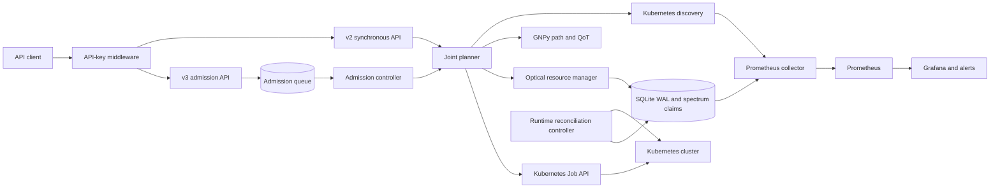
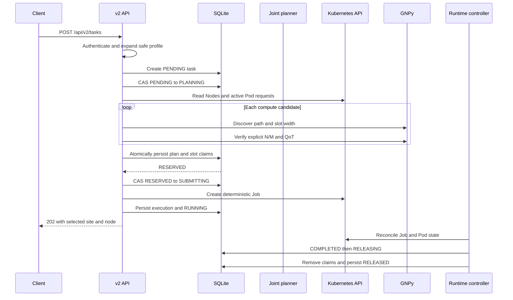
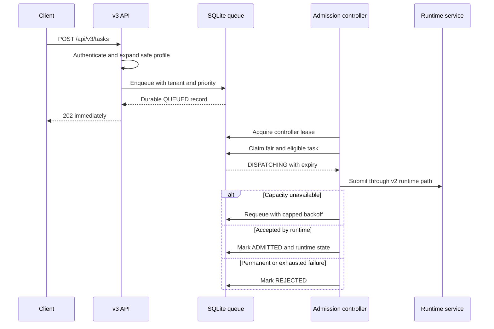
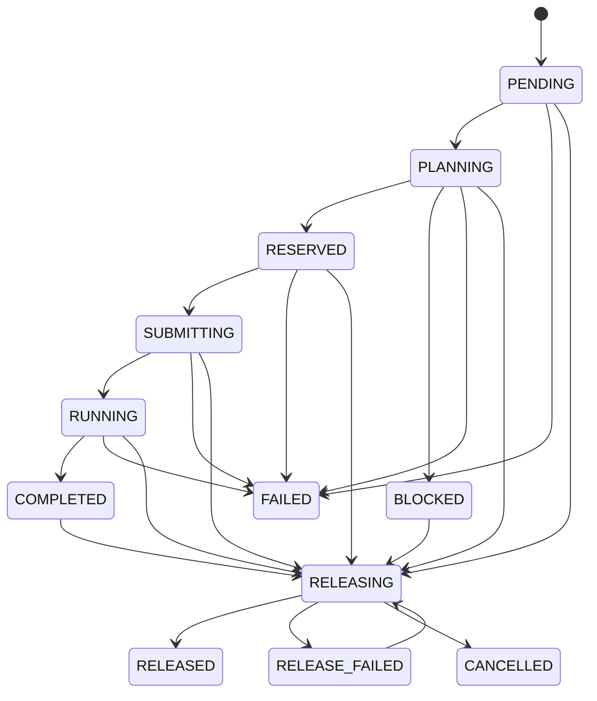
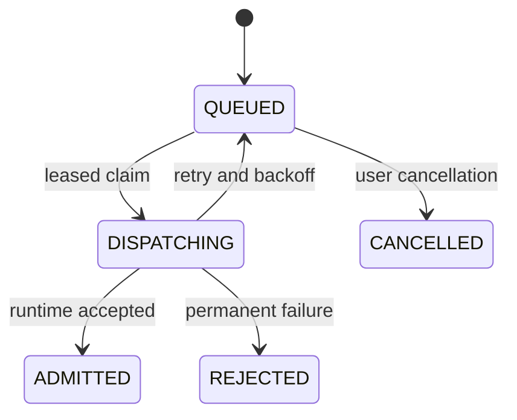

# Architecture and lifecycle contracts

This document describes the v13 working-tree architecture. The public release
version should be `v0.1.0`; `v13` is an internal engineering milestone, not a
semantic version.

## Logical architecture

The deployment is intentionally single-replica. SQLite, a RWO PVC, the
in-memory optical occupancy model, and process-local operation locking are a
coherent single-controller design, not a multi-replica control plane.

## v2 synchronous submission

If Job creation succeeds but execution persistence fails, the service deletes
the deterministic Job and releases the optical reservation. A later leased
reconciliation pass handles process interruption in `RESERVED`, `SUBMITTING`,
`RUNNING`, `COMPLETED`, `RELEASING`, or `RELEASE_FAILED`.

## v3 asynchronous admission

Tenant rotation is fair across active tenants. Priority aging applies inside
one tenant. This is not Dominant Resource Fairness and does not implement
preemption, gang admission, or hierarchical quotas.

## Runtime state machine

All repository updates validate the transition graph. Mutable runtime rows
carry an incrementing version and use compare-and-swap updates so stale
controllers cannot silently overwrite newer state.

## Admission state machine

`DISPATCHING` records contain a claim expiry. Recovery only reclaims an
expired record, preventing an active worker from being immediately preempted.

## Persistence and ownership

| Resource | Source of truth | Protection |
| --- | --- | --- |
| Compute availability | Kubernetes Nodes minus active Pod requests | Live discovery before every plan |
| Task lifecycle | SQLite runtime task row | Transition validation and CAS version |
| Optical allocation | SQLite plan plus in-memory occupancy | Unique link/slot claim rows |
| Kubernetes execution | Kubernetes Job and Pod | Deterministic Job name and reconciliation |
| Admission | SQLite queue row | Transactional limits, lease and claim expiry |
| Controller leadership | SQLite lease row | Named renewable lease |

## Failure boundary

The prototype configures no physical optical device. GNPy validates a modeled
path and QoT; the selected spectrum is a control-plane claim. Production use
would require a southbound optical controller, distributed persistence,
Kubernetes-native leader election, admission policy, secret rotation, and
operational SLOs.
